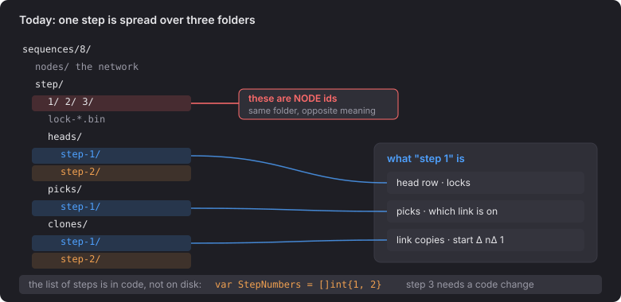

# 1 · Now

- To see one step, you have to open three folders: `heads/step-1`, `picks/step-1` and `clones/step-1`.
- `step/1/` is node 1, while `heads/step-1/` is step 1.
- The list of steps lives in code (`step_picks.go:19`), not on disk.
