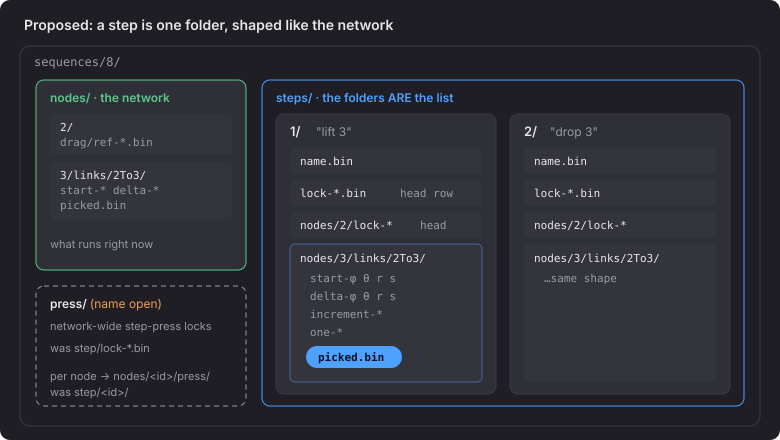
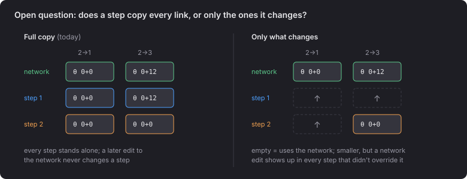

# 2 · Proposed folders

- A step holds the same `nodes/<id>/links/<from>To<to>/` layout as the network, so the reader
  that loads the network's links also loads a step's links.
- `steps/` is an array indexed by folder name, the same as `sequences/` already is.

## Open question: full copy or only what changes

