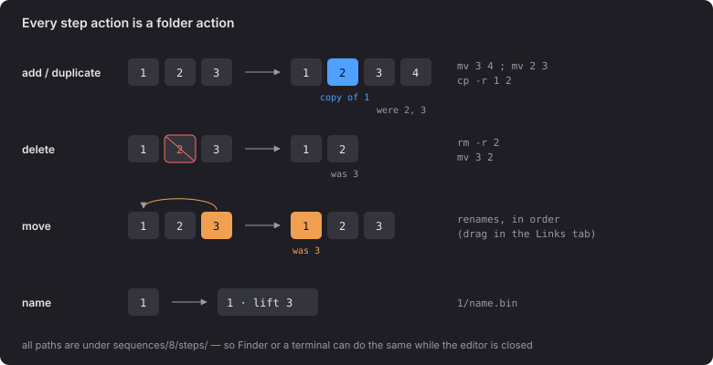

# 3 · Step actions

| Old | New |
|---|---|
| `step/clones/step-N/<to>/links/<f>To<t>/` | `steps/N/nodes/<to>/links/<f>To<t>/` |
| `step/picks/step-N/<f>To<t>.bin` | `steps/N/nodes/<t>/links/<f>To<t>/picked.bin` |
| `step/heads/step-N/lock-*.bin` | `steps/N/lock-*.bin` |
| `step/heads/step-N/<id>/lock-*.bin` | `steps/N/nodes/<id>/lock-*.bin` |
| `step/lock-*.bin` | `press/lock-*.bin` |
| `step/<id>/lock-*.bin` | `nodes/<id>/press/lock-*.bin` |
