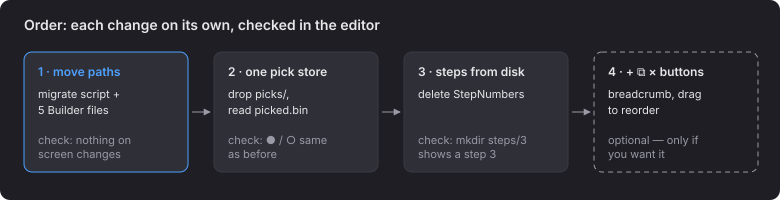

# 5 · Order

| File | Change |
|---|---|
| `Builder/step_picks.go` | `StepNumbers` is read from `steps/`; picks are `picked.bin` |
| `Builder/step_links.go` | `steps/N/nodes` |
| `Builder/step_heads.go` | `steps/N` |
| `Builder/step_files.go` | `press/`, `nodes/<id>/press/` |
| `Builder/pill_links.go` | loops over the steps read from disk |
| `Scene/Startup/fit_s.go:66` | reads `steps/*/nodes` |
| new `scripts/migrate-steps/` | one-time migration |

**Open:** the name `press/` · full copy or only what changes (page 2) · folders for sequences
